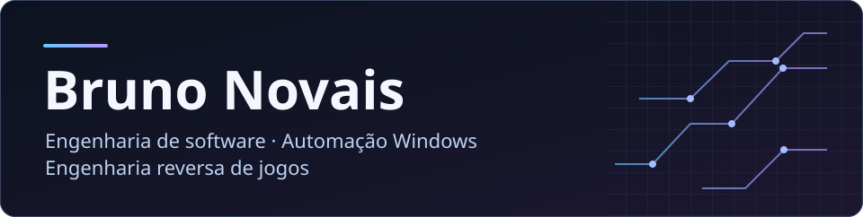

  

Desenvolvo aplicações web em tempo real e ferramentas para Windows. Em engenharia reversa de jogos, trabalho com análise de replays de CS2, formatos binários, memória de processos e APIs Win32. Documento o que observei, como reproduzir e onde o resultado ainda tem limites.

## Projetos em destaque

<table>
  <tr>
    <td width="50%" valign="top">
      
      <h3>EchoLive</h3>
      
Salas privadas com voz, vídeo e chat em tempo real.

      <a href="https://github.com/brunoo-code/EchoLive#demo">Ver demo</a> · <a href="https://github.com/brunoo-code/EchoLive">Código</a>
    </td>
    <td width="50%" valign="top">
      
      <h3>CS2 Replay Lab</h3>
      
Radar interativo de Mirage gerado a partir de um replay real.

      <a href="https://brunoo-code.github.io/cs2-replay-lab/example/">Abrir radar</a> · <a href="https://github.com/brunoo-code/cs2-replay-lab">Código</a>
    </td>
  </tr>
</table>

### Mais projetos

- [bnqq-toolkit](https://github.com/brunoo-code/bnqq-toolkit) · Diagnóstico de hardware e ajustes de latência no Windows.
- [Save File Lab](https://github.com/brunoo-code/save-file-lab) · Comparação e edição de saves binários com validação CRC.
- [Game Memory Lab](https://github.com/brunoo-code/game-memory-lab) · Busca diferencial de valores em memória com APIs Win32.

## Tecnologias dos projetos

## Contribuições

<picture>
  <source media="(prefers-color-scheme: dark)" srcset="./assets/contributions-dark.svg">
  <source media="(prefers-color-scheme: light)" srcset="./assets/contributions.svg">
  
</picture>
