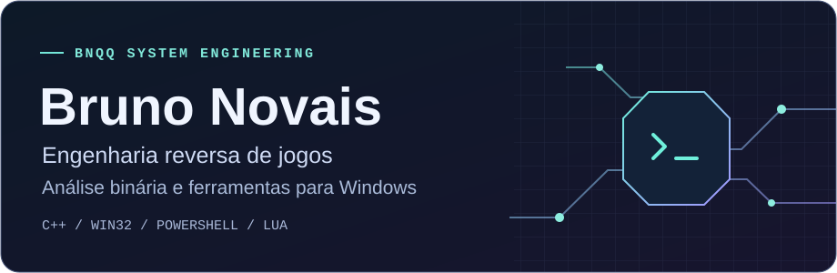
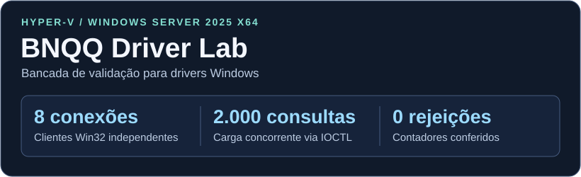
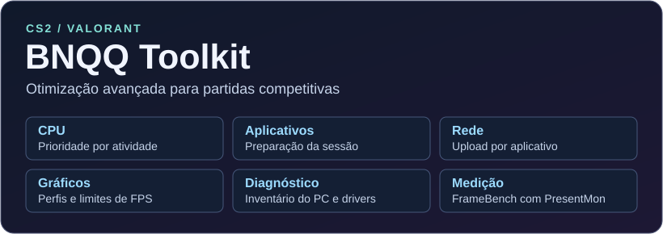
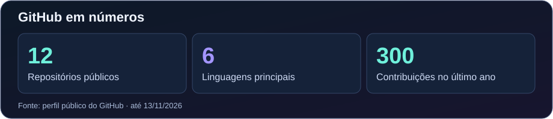
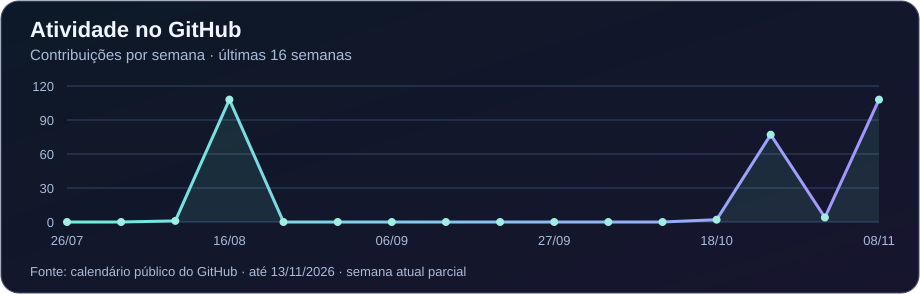

  

  <a href="#projetos-em-destaque">Projetos</a> · <a href="#tecnologias">Tecnologias</a> · <a href="#contribuições">Contribuições</a>

Desenvolvo ferramentas de engenharia reversa para jogos e Windows. Trabalho com **formatos binários**, **memória de processos** e **automação**. Nos projetos abaixo, mostro o que consegui inspecionar, medir ou reproduzir.

| Análise binária | Depuração de kernel | Desempenho em jogos |
| :---: | :---: | :---: |
| **339 entradas** verificadas no PAK original do Quake | **2.002 consultas aceitas** na bancada Hyper‑V | **6 frentes** de otimização e medição para CS2 e VALORANT |
| [Quake PAK Inspector](https://github.com/brunoo-code/quake-pak-inspector) | [BNQQ Driver Lab](https://github.com/brunoo-code/win-kernel-telemetry/blob/main/docs/hyperv-validation.md) | [BNQQ Toolkit](https://github.com/brunoo-code/bnqq-toolkit) |

## Projetos em destaque

<table>
  <tr>
    <td valign="top">
      
      <h3>Quake PAK Inspector</h3>
      
Inspetor de arquivos binários em <strong>C++20 e Win32</strong>. Navegue pelos recursos do Quake, compare dois pacotes em hexadecimal e confira qual mod sobrescreve cada arquivo pela CLI. Validado com 339 entradas do Quake 1.06 shareware.

      <a href="https://github.com/brunoo-code/quake-pak-inspector/releases/latest">Baixar demo</a> · <a href="https://github.com/brunoo-code/quake-pak-inspector#hub-de-mods-em-c-e-lua">Hub de mods em Lua</a> · <a href="https://github.com/brunoo-code/quake-pak-inspector">Código</a>
    </td>
  </tr>
</table>

<table>
  <tr>
    <td valign="top">
      
      <h3>BNQQ Driver Lab · Hyper‑V</h3>
      
VM Windows Server 2025 x64 usada para validar o <strong>BNQQ Kernel Telemetry</strong>, um driver WDM em C++ com cliente Win32. A bancada reúne uma sessão de depuração de kernel com KD do pacote WinDbg e um teste de carga com oito conexões simultâneas.

      <a href="https://github.com/brunoo-code/win-kernel-telemetry/blob/main/docs/hyperv-validation.md#teste-de-carga-concorrente">Ver teste de carga</a> · <a href="https://github.com/brunoo-code/win-kernel-telemetry/blob/main/docs/hyperv-validation.md#depurador">Ver depuração</a> · <a href="https://github.com/brunoo-code/win-kernel-telemetry">Código</a>
    </td>
  </tr>
</table>

<table>
  <tr>
    <td width="50%" valign="top">
      <h3>Game Memory Lab</h3>
      
Busca diferencial de valores e leitura e escrita de memória de um processo de demonstração pelas APIs Win32.

      <a href="https://github.com/brunoo-code/game-memory-lab">Ver projeto</a>
    </td>
    <td width="50%" valign="top">
      <h3>Aim Overlay Lab</h3>
      
Protótipo em C++20 que projeta coordenadas 3D na tela e visualiza a seleção de alvos em uma arena offline.

      <a href="https://github.com/brunoo-code/aim-overlay-lab">Ver projeto</a>
    </td>
  </tr>
</table>

<table>
  <tr>
    <td valign="top">
      
      <h3>BNQQ Toolkit</h3>
      
<strong>Otimizador avançado para quem leva CS2 e VALORANT competitivo a sério.</strong> O BNQQ atua em seis frentes do PC para reduzir a interferência de tarefas em segundo plano e buscar quadros mais consistentes. Foi feito para jogadores que querem investigar stutter e input lag e medir o efeito dos ajustes no próprio setup.

      <ul>
        <li><strong>CPU e aplicativos.</strong> O Start Competitivo prepara a sessão, preserva os apps escolhidos e ajusta a prioridade dos processos selecionados conforme a atividade.</li>
        <li><strong>Rede e gráficos.</strong> Limite o upload de apps de sincronização, configure limites de FPS para menu e partida no CS2 e ajuste preferências gráficas locais do VALORANT.</li>
        <li><strong>Diagnóstico e medição.</strong> Consulte hardware e drivers e compare rodadas com o FrameBench e o PresentMon usando 1% e 0,1% lows e p99 de tempo de quadro. Para confirmar input lag de ponta a ponta, use uma medição específica de mouse até tela.</li>
      </ul>
      <a href="https://github.com/brunoo-code/bnqq-toolkit">Conhecer o BNQQ Toolkit</a> · <a href="https://github.com/brunoo-code/bnqq-toolkit/blob/main/docs/COMPETITIVE-START.md#menu-29-start-competitivo">Ver Start Competitivo</a> · <a href="https://github.com/brunoo-code/bnqq-toolkit#medir-antes-de-concluir">Como medir</a>
    </td>
  </tr>
</table>

### Mais projetos

<table>
  <tr>
    <td width="50%" valign="top">
      
      <h3>EchoLive</h3>
      
Salas privadas com voz, vídeo e chat em tempo real.

      <a href="https://github.com/brunoo-code/EchoLive#demo">Ver demo</a> · <a href="https://github.com/brunoo-code/EchoLive">Código</a>
    </td>
    <td width="50%" valign="top">
      
      <h3>CS2 Replay Lab</h3>
      
Radar interativo de Mirage gerado a partir de um replay real.

      <a href="https://brunoo-code.github.io/cs2-replay-lab/example/?v=21565ca">Abrir radar</a> · <a href="https://github.com/brunoo-code/cs2-replay-lab">Código</a>
    </td>
  </tr>
</table>

- [Save File Lab](https://github.com/brunoo-code/save-file-lab) · Comparação e edição de saves binários com validação CRC.

## Tecnologias

| Área | Ferramentas |
| --- | --- |
| **Sistemas e diagnóstico** |      |
| **Scripts e formatos** |     |
| **Web em tempo real** |    |

## Contribuições

  
  

[Ver histórico de contribuições no GitHub](https://github.com/brunoo-code#js-contribution-activity)

<!-- Atualize os cards e o gráfico com python tools/update-profile-stats.py. -->

<picture>
  <source media="(prefers-color-scheme: dark)" srcset="./assets/contributions-dark.svg">
  <source media="(prefers-color-scheme: light)" srcset="./assets/contributions.svg">
  
</picture>
