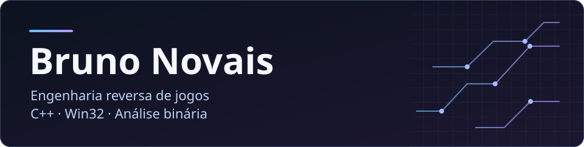
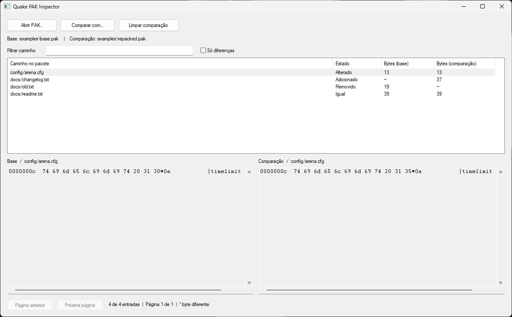
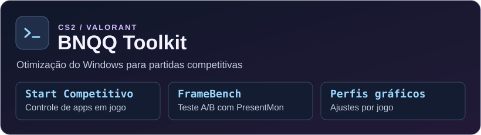
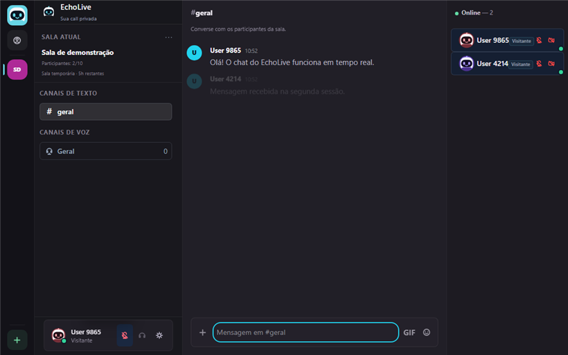
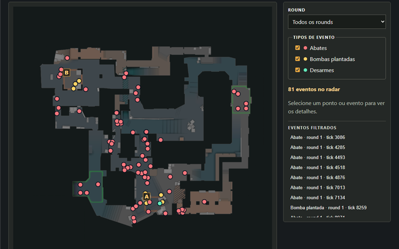

  

Desenvolvo ferramentas de engenharia reversa para jogos e Windows. Trabalho com C++ e APIs Win32, análise de formatos binários, leitura e manipulação de memória de processos e automação.

## Projetos em destaque

<table>
  <tr>
    <td valign="top">
      
      <h3>Quake PAK Inspector</h3>
      
Inspetor de arquivos binários em <strong>C++20 e Win32</strong>. Navegue pelos recursos do Quake, compare dois pacotes em hexadecimal e confira qual mod sobrescreve cada arquivo pela CLI. Validado com 339 entradas do Quake 1.06 shareware.

      <a href="https://github.com/brunoo-code/quake-pak-inspector/releases/latest">Baixar demo</a> · <a href="https://github.com/brunoo-code/quake-pak-inspector">Código</a>
    </td>
  </tr>
</table>

<table>
  <tr>
    <td width="50%" valign="top">
      <h3>Game Memory Lab</h3>
      
Busca diferencial de valores e leitura e escrita de memória de um processo de demonstração pelas APIs Win32.

      <a href="https://github.com/brunoo-code/game-memory-lab">Ver projeto</a>
    </td>
    <td width="50%" valign="top">
      <h3>Aim Overlay Lab</h3>
      
Protótipo em C++20 que projeta coordenadas 3D na tela e visualiza a seleção de alvos em uma arena offline.

      <a href="https://github.com/brunoo-code/aim-overlay-lab">Ver projeto</a>
    </td>
  </tr>
</table>

<table>
  <tr>
    <td valign="top">
      
      <h3>BNQQ Toolkit</h3>
      
Prepare o Windows para partidas de <strong>CS2 e VALORANT</strong>. O BNQQ analisa o PC, mostra quais ajustes pode aplicar e ajuda a medir o impacto no seu hardware.

      <ul>
        <li><strong>Start Competitivo.</strong> Abre o jogo pelo Steam ou Riot Client, preserva os apps que você escolher e ajusta a prioridade dos apps selecionados quando eles disputam CPU. O modo de sessão pode limitar o upload de apps de sincronização.</li>
        <li><strong>FrameBench com PresentMon.</strong> Compare rodadas antes e depois usando 1% e 0,1% lows, p99 e p99,9 de tempo de quadro. Assim dá para conferir se os quadros mais lentos melhoraram.</li>
        <li><strong>Perfis gráficos por jogo.</strong> Configure limites de FPS separados para menu e partida no CS2 e ajuste as preferências gráficas locais do VALORANT.</li>
      </ul>
      <a href="https://github.com/brunoo-code/bnqq-toolkit/blob/main/docs/COMPETITIVE-START.md#menu-29-start-competitivo">Ver Start Competitivo</a> · <a href="https://github.com/brunoo-code/bnqq-toolkit#medir-antes-de-concluir">Como medir</a> · <a href="https://github.com/brunoo-code/bnqq-toolkit">Código</a>
    </td>
  </tr>
</table>

### Mais projetos

<table>
  <tr>
    <td width="50%" valign="top">
      
      <h3>EchoLive</h3>
      
Salas privadas com voz, vídeo e chat em tempo real.

      <a href="https://github.com/brunoo-code/EchoLive#demo">Ver demo</a> · <a href="https://github.com/brunoo-code/EchoLive">Código</a>
    </td>
    <td width="50%" valign="top">
      
      <h3>CS2 Replay Lab</h3>
      
Radar interativo de Mirage gerado a partir de um replay real.

      <a href="https://brunoo-code.github.io/cs2-replay-lab/example/?v=21565ca">Abrir radar</a> · <a href="https://github.com/brunoo-code/cs2-replay-lab">Código</a>
    </td>
  </tr>
</table>

- [Save File Lab](https://github.com/brunoo-code/save-file-lab) · Comparação e edição de saves binários com validação CRC.

## Tecnologias dos projetos

## Contribuições

<picture>
  <source media="(prefers-color-scheme: dark)" srcset="./assets/contributions-dark.svg">
  <source media="(prefers-color-scheme: light)" srcset="./assets/contributions.svg">
  
</picture>
